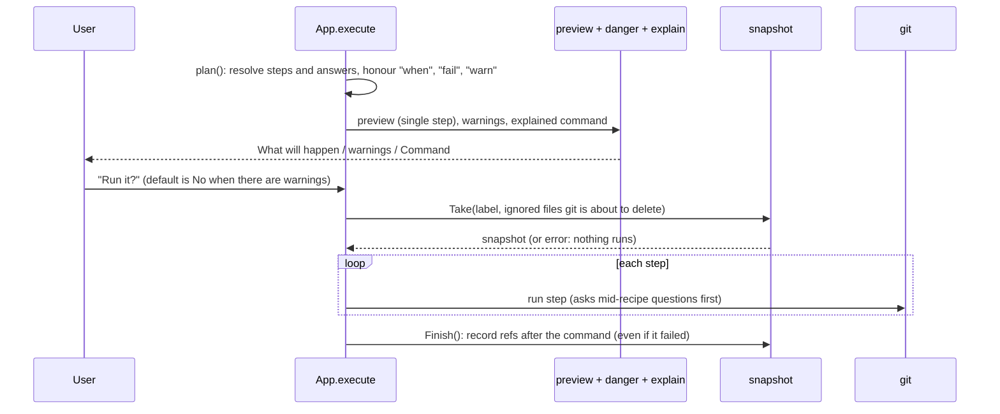

# Architecture

This document explains how gitwhy is built: what each part does, how a command flows through
the program, what is stored on disk, and why the main design choices were made. For what gitwhy
does and how to install it, see [README.md](README.md). To add a recipe, a danger rule or a
documented command, see [CONTRIBUTING.md](CONTRIBUTING.md).

## Contents

1. [The idea in one paragraph](#the-idea-in-one-paragraph)
2. [Design rules](#design-rules)
3. [Repository layout](#repository-layout)
4. [How a command flows](#how-a-command-flows)
5. [The undo engine](#the-undo-engine)
6. [Previews and warnings](#previews-and-warnings)
7. [Recipes](#recipes)
8. [The command reference (docs, search, explain)](#the-command-reference-docs-search-explain)
9. [The full-screen home (TUI)](#the-full-screen-home-tui)
10. [The shell hook](#the-shell-hook)
11. [Recover](#recover)
12. [Testing](#testing)
13. [Build, release and packaging](#build-release-and-packaging)
14. [Decisions and trade-offs](#decisions-and-trade-offs)
15. [Known limits](#known-limits)

## The idea in one paragraph

gitwhy is a single Go binary that runs the **real `git`** for you. Before it changes anything it
shows what will happen (using git's own dry runs where it can), explains every part of the
command in plain English, warns about danger, and saves a **snapshot** of the repository. After
it runs, `gitwhy undo` puts the snapshot back. Everything is local: there is no network call, no
account and no AI at run time.

## Design rules

These rules explain most of the code. When you change something, keep them true.

1. **Only `internal/git` starts git.** Every other package calls `git.Runner` or `git.Repo`, so
   there is one place that sets the environment (`LC_ALL=C`, no terminal prompts) and wraps errors.
2. **Nothing changes the repository without a snapshot.** The one exception is staging and
   unstaging (including single hunks and lines in the TUI): it is always reversible, so it runs
   directly.
3. **Previews never change the repository.** They use read-only plumbing such as `merge-tree`,
   `rev-list`, `diff` and `--dry-run`.
4. **If a snapshot cannot be taken, nothing runs.** A failed snapshot stops the command.
5. **Undo never overwrites later work.** It only moves refs that are still where gitwhy left
   them, and it reports what it left alone.
6. **No AI, no network, no secrets at run time.** The binary only talks to the local `git`.
7. **Text for users is plain English and short.** The docs follow [docs/STYLE.md](docs/STYLE.md).
8. **Needs git 2.40 or newer** (`checkGit` in `cmd/gitwhy/main.go`), because previews rely on
   `git merge-tree --write-tree --merge-base`.

## Repository layout

```
cmd/gitwhy/            program entry: argument routing, version, git version check, e2e tests
embed.go               embeds docs/commands, docs/shared and recipes/ into the binary
internal/
  git/                 the only package that starts git processes
  snapshot/            save and restore repository state (the undo engine)
  recover/             read reflogs: what happened recently, lost commits
  preview/             predict what a command will do, without doing it
  danger/              warn about commands that lose work or rewrite shared history
  explain/             break a command into tokens with a plain-English meaning each
  kb/                  parse docs/ markdown into commands and flags
  search/              rank recipes, commands and flags against a few words
  recipe/              recipe model: questions, steps, checks, templates
  todo/                rewrite a "git rebase -i" todo list from a plan
  hunk/                parse a diff into hunks; build patches for partial staging
  graph/               parse "git log --graph" into rows
  hook/                shell function support: snapshot before plain git commands
  tui/                 Bubble Tea full-screen home
  ui/                  interactive CLI: wizards, menus, run, undo, recover
  testrepo/            throwaway git repositories for tests
recipes/               60 YAML recipes (goals such as "undo last commit")
docs/commands/         one markdown file per git command (181), with every flag explained
docs/shared/           option tables shared by several commands
third_party/clipboard/ vendored copy of atotto/clipboard (see Decisions)
npm/                   npm package that downloads the release binary
scripts/               repo and package builders, docs tools, install tests
install.sh, install.ps1  one-line installers
flake.nix              Nix build
.goreleaser.yaml       release build and publishing
.github/workflows/     CI, package tests, release, post-release install checks
```

Packages depend downward only. The engine packages (`git`, `snapshot`, `recover`, `preview`,
`danger`, `explain`, `kb`, `search`, `recipe`, `todo`, `hunk`, `graph`, `hook`) have **no user
interface**. `ui` and `tui` sit on top of them, and `cmd/gitwhy` wires everything together.

```mermaid
flowchart TD
    main["cmd/gitwhy (routing)"] --> ui
    main --> hook
    ui --> tui
    ui --> recipe
    ui --> preview
    ui --> danger
    ui --> explain
    ui --> snapshot
    ui --> recover
    ui --> search
    ui --> todo
    tui --> hunk
    tui --> graph
    tui --> recipe
    preview --> danger
    explain --> kb
    search --> kb
    search --> recipe
    hook --> danger
    hook --> preview
    hook --> snapshot
    snapshot --> git
    recover --> git
    preview --> git
    tui --> git
```

## How a command flows

`cmd/gitwhy/main.go` looks at the first argument and routes it:

| Input | What happens |
|---|---|
| `__todo <plan> <file>` | git is calling us as its rebase sequence editor: `todo.Apply` rewrites the file. |
| `__pre ...` / `__post <id>` | The shell hook: `hook.Pre` / `hook.Post`. These skip `checkGit` and the docs so they stay fast. |
| `hook init|install|uninstall` | Print or edit the shell hook. |
| none | Full-screen home (`App.TUI`) in a terminal, or the simple menu (`App.Home`) otherwise. |
| `run`, `menu`, `explain`, `do`, `build`, `undo`, `recover`, `resolve`, `continue`, `abort` | The matching `App` method. |
| anything else | The words are a search query (`App.Search`). |

`ui.New` loads the embedded docs and recipes and builds the search index once per run.

### The run pipeline

Both `gitwhy run git ...` (a literal command) and every recipe end in `App.execute`
(`internal/ui/run.go`). This is the heart of the program:



Key points:

- **`plan`** turns a job (a recipe with answers, or one literal command) into concrete argument
  lists. Answers that are asked later are shown as `<name>` placeholders. A `fail` step stops
  everything before anything runs.
- **Exact previews exist only for a single step.** For several steps, the recipe's `predict`
  text is shown instead.
- **`Confirm` defaults to No when any warning was shown**, and to Yes otherwise.
- **`snapshot.Take` runs after you confirm and before the first step.** Its `extra` argument
  lists ignored files the command is about to delete (from the preview), so undo can bring those
  back too.
- **`Finish` runs in a `defer`**, so the "after" state is recorded even when a step fails. Undo
  uses it to know which refs gitwhy's command changed.
- Recipes run at the repository root (their paths are root-relative). Literal commands run in the
  folder you started gitwhy from.

## The undo engine

Package `internal/snapshot`. A snapshot lives in `<gitdir>/gitwhy/snapshots/<id>/` and holds:

| Part | How it is stored |
|---|---|
| Every ref and `HEAD` | `meta.json` (`Refs`, `Head`); symbolic refs and `refs/gitwhy`, `refs/stash` are not copied as refs |
| The index | a byte-for-byte copy, so conflict stages and flags survive exactly |
| The working tree | one commit (`Work`) of tracked and untracked files, not ignored ones. It is made with a temporary index seeded from the real one, so `git add -A` stays fast |
| Ignored files git is about to delete | added to that commit (`extra`) |
| An operation in progress | the state files of a merge, rebase, cherry-pick, revert or bisect |
| Sparse-checkout settings | config values and files |
| Stashes | the stash list (`Stashes`) |

The working-tree commit has as parents every commit that `HEAD`, a ref (branches, tags and
remote-tracking branches; tags are peeled to their commit) or a stash entry points to, and a ref
`refs/gitwhy/snapshots/<id>` keeps it alive. Other objects refs point to, such as annotated tag
objects, are kept alive by `refs/gitwhy/snapshots/<id>-<object ID>`. So `git gc` cannot delete what
undo needs. The last **20** snapshots per worktree are kept (`Keep`). Pruning also removes the folders
of interrupted snapshots (no `meta.json`, older than 10 minutes) and any snapshot ref whose ID has no
folder in any worktree of the repository (for example after `git worktree remove`).

`Finish` runs after the command and records the refs and the stash list as they are then (`After`),
so undo can tell what the command changed from what you changed later.

**Restore** (`Restore`) works in this order:

1. It checks that everything it needs still exists (the saved working-tree commit and the commit
   `HEAD` was on) **before touching anything**, and stops with a plain message if `gc` removed it.
2. It saves the current state as a new snapshot (`Result.Before`), so an undo can itself be undone.
   Ignored files the undo is about to overwrite or delete (including ones inside a folder that
   replaces a file) are added to it first (`overwrittenUnsaved`).
3. It moves refs in two steps: refs that go away are deleted in one transaction, then the rest are
   written back in another, so `foo` and `foo/bar` can swap places. If the second step fails, the
   deleted refs are created again, so a failure there changes nothing.
4. It restores `HEAD`, the index, working-tree files and any deleted objects. If some file cannot
   be written or removed it still restores all the others, then reports the errors and says that
   running `gitwhy undo` again returns to the state before this undo.
5. It calls `Finish` on the "before" snapshot, so redoing an undo also leaves later work alone.

Rules that protect your work:

- A ref is restored only if it is still at the value `Finish` recorded (`After`). A branch you
  moved afterwards, in plain git or another worktree, is left alone and listed in
  `Result.Skipped`.
- If the branch `HEAD` was on is skipped, checked out in another worktree, or its commits are gone,
  `HEAD`, the index and the files are left alone too (they would not match the branch).
- Stashes made after the command are kept: they are put back on top of the restored list.
- Branches checked out in another worktree are not touched (`checkedOutElsewhere`).
- Sparse-checkout settings are restored in the shared config file only; `config.worktree` is copied
  as a file, so one worktree's settings never leak into another.
- Submodules (gitlinks) are handled separately from regular files.

File names are literal: `internal/git` runs every git command with `GIT_LITERAL_PATHSPECS=1`, so a
file called `[ab].txt` never matches `a.txt`. Commands the user typed (`gitwhy run git ...`) and
their previews turn that off again, so a quoted `'*.c'` still globs like the real git.

Anything already sent to a remote (`push`) cannot be undone locally. The danger rules say so.

## Previews and warnings

**`internal/preview`** returns lines describing what a command will do and whether the answer is
`Exact`. It handles `reset`, `clean`, `rm`, `add`, `mv`, `merge`, `rebase`, `cherry-pick`,
`revert`, `branch`, `stash`, `switch`, `checkout`, `push` and `commit`, using git's dry runs and
read-only plumbing.
Merge, rebase, cherry-pick and revert previews simulate the result with `git merge-tree` and
report conflicts **before** they happen. It never touches the repository.

**`internal/danger`** is a table of rules. Each rule names a command, a condition on the parsed
flags and a plain-English warning. `Warnings(args)` returns the warnings for a command line. The
table is also the source of truth for the shell hook (see below): `Commands()` lists every
command with a rule.

**`internal/explain`** splits a command line into parts and attaches the meaning of each flag
from the embedded docs, and a short description of each revision (`HEAD~1` becomes "1 commit(s)
before the commit you're on now").

## Recipes

A recipe (`recipes/*.yaml`, model in `internal/recipe`) is a goal such as "Undo last commit":

```yaml
title: Copy a commit from another branch
aliases: [cherry-pick, copy commit]
category: branches
questions:
  - {id: from, ask: "Which branch has the commit?", type: branch, source: all}
  - {id: commit, ask: "Which commit?", type: commit, source: "HEAD..{{.from}}"}
steps:
  - git: [cherry-pick, "{{.commit}}"]
predict: A copy of {{.commit}} is added on top of {{.branch}}.
```

- **Questions** have a type (`choice`, `confirm`, `text`, `branch`, `commit`, `files`, `remote`,
  `todo`). The wizard (`internal/ui/wizard.go`) asks them with `huh` forms, or plain line prompts
  when `ACCESSIBLE=1`.
- **Steps** are git argument lists. Arguments are Go templates over the answers; an argument that
  is just `{{.x}}` expands a list answer into several arguments, so values never go through a
  shell. A step can have `when`, `ask` (ask a question mid-recipe), `fail` (stop before running),
  `warn`, `env` and `todo` (edit a rebase todo list).
- **Checks** (`internal/recipe/checks.go`) are named situation tests, such as `dirty-tree` or
  `detached-head`. A check can warn, block, or suggest another recipe.
- **`todo` steps** run `git rebase -i` without an editor. git is told to call
  `gitwhy __todo <plan> <todo-file>` as its sequence editor (`todo.Editor`); `todo.Apply` rewrites
  the todo list from the plan.

The recipes are embedded into the binary (`embed.go`), so they work offline and ship in one file.

## The command reference (docs, search, explain)

`docs/commands/<command>.md` documents each git command: a summary and a table of every flag with
a short meaning. `internal/kb` parses these files at start-up into `Command`, `Sub` and `Flag`
values. `internal/search` builds an index over recipes, commands and flags and ranks them against
the words you typed. `explain` and the `build` wizard read flags from the same data.

Two scripts keep the docs honest: `scripts/check_coverage.py` reports flags in your installed
git's `-h` and man output that are missing from the docs, and `scripts/build_index.py` rebuilds
`docs/README.md`.

## The full-screen home (TUI)

`internal/tui` is a [Bubble Tea](https://github.com/charmbracelet/bubbletea) program with three
tabs: Changes, Commits and Branches. It **only reads** the repository, apart from stage and
unstage. When you press a key that needs a recipe, it returns an `Action` (`recipe`, `search`,
`undo`, `recover`, `build` or `quit`), `App.TUI` runs it through the normal run pipeline, waits
for Enter, and reopens the TUI.

- **Hunk and line staging** (`hunks.go`, `internal/hunk`): `enter` on a changed file opens its
  hunks. `internal/hunk` parses `git diff` for one file and builds a partial patch that is applied
  with `git apply --cached --recount` (add `-R` to unstage). The diff format is pinned
  (`--no-color --no-ext-diff`, fixed prefixes) so user config cannot break parsing. Line mode is
  refused for hunks that touch a missing final newline and for whole-file adds and deletes.
- **Commit graph** (`internal/graph`): the Commits tab shows `git log --graph`. Connector rows are
  drawn but never selectable. Commits that are not in `HEAD`'s history refuse history-rewriting
  keys. The graph is only loaded while the Commits tab is shown, because `--graph` can walk all
  history in repositories without a commit-graph file.

## The shell hook

`gitwhy hook install` adds a small `git()` shell function (bash and zsh) to your startup file. For
each command it calls `gitwhy __pre <args>` first. `hook.Pre` takes a snapshot only for commands
that are risky and local, and prints its ID. After git exits, the function calls
`gitwhy __post <id>`. The function always runs the real git and keeps its exit code, even if
gitwhy is missing or fails.

To stay fast, the generated function has a `case` on the subcommand: only commands that have a
danger rule (`danger.Commands()`, without `push`) spawn `gitwhy` at all. `Pre` skips global
options (`-C`, `-c`, `--git-dir`), non-repositories, bare repositories and `GITWHY_HOOK_OFF=1`.

## Recover

`internal/recover` reads the reflogs of `HEAD` and your branches and turns them into events such
as "pulled 14 commits from origin/master", each with the command that goes back. It works for
commands run in plain git, with no snapshot. `LostObjects` finds unreachable commits, such as ones
from a deleted branch or a hard reset, and dangling staged files.

## Testing

| Layer | Where | What it uses |
|---|---|---|
| Unit tests | `internal/*/*_test.go` | real git in temporary repositories (`internal/testrepo`), no mocks of git |
| TUI tests | `internal/tui/*_test.go` | the model is driven directly with `m.key("...")` |
| End-to-end | `cmd/gitwhy/e2e_test.go` | builds the real binary and answers prompts through `ACCESSIBLE=1` plain-text mode |
| npm package | `npm/lib.test.js` | `node --test` |
| Package and repo install | `scripts/test-repos.sh`, `scripts/test-pkgs.sh` | Docker: builds the signed apt and dnf repos with a throwaway key, installs from them, checks that tampering is rejected |
| After each release | `.github/workflows/verify-install.yml` | installs the real release with apt, dnf, npm, Homebrew, Scoop and PowerShell |

CI (`.github/workflows/ci.yml`) is one pipeline with these jobs, and `fail-fast` everywhere:

| Job | What it checks |
|---|---|
| `setup` | dependencies download and verify (`go mod verify`), `go.mod` and `go.sum` are tidy, the whole module compiles |
| `lint` | `gofmt`, `go vet`, `golangci-lint`, `govulncheck`, `actionlint`, `shellcheck`, syntax of the npm and Python files, and that `THIRD_PARTY_LICENSES` is up to date |
| `test` | the full suite on Linux and Windows. Linux also measures statement coverage and fails below the floor (`COVERAGE_FLOOR` in `ci.yml`). Windows also runs the remote tests with `core.autocrlf=true` (the Git for Windows default) and `install.ps1` under PowerShell 7 and 5.1 |
| `build` | `goreleaser check`, a snapshot build of every release artifact, then `scripts/test-repos.sh` and `scripts/test-pkgs.sh` install them in clean containers. The artifacts are kept for 7 days |
| `nix` | builds the Nix flake (fails when `vendorHash` is stale) |

Coverage counts only what `go test` runs in-process. The end-to-end tests run the built binary, so
they prove behavior but are not counted: `cmd/gitwhy` and `internal/ui` show 0%. Every third-party
action is pinned to a full commit SHA and every tool to an exact version; Dependabot proposes the
updates. `.github/workflows/check-secrets.yml` (manual) checks that the release secrets are set and
that the Homebrew token can write to the tap.

## Build, release and packaging

A tag `v*` triggers `.github/workflows/release.yml`. It calls the CI pipeline first, so nothing is
published unless lint, tests and the build pass. Releases run one at a time and are never cancelled.

1. **`release` job**: goreleaser builds Linux, macOS and Windows binaries (amd64 and arm64), `.deb`,
   `.rpm`, `.apk` and Arch packages, checksums, and a GitHub release. The archives and packages
   include `THIRD_PARTY_LICENSES`, and the `.deb`/`.rpm` require `git >= 2.40`. It also publishes a
   Homebrew cask and a Scoop manifest to the `homebrew-gitwhy` repository, and (with a token) opens
   a winget PR.
2. **`repos` job**: builds a signed apt repository and dnf repository from the release's packages
   (`scripts/build-repos.sh`) and publishes them to the `gh-pages` branch, served by GitHub Pages.
3. **`npm` job**: publishes `@kaitlynbassford/gitwhy` (with provenance), a package that downloads
   and verifies the release binary.
4. **`verify-install`** then installs the new release every supported way (apt, dnf, npm, Homebrew,
   Scoop, `install.ps1`, `install.sh`, Nix) on real operating systems, waiting for GitHub Pages to
   publish, and fails if any of them reports the wrong version.

`install.sh` and `install.ps1` download the release archive and **verify its SHA-256 against
`checksums.txt` before installing**. `flake.nix` builds from source for Nix.

## Decisions and trade-offs

- **Wrap git, do not reimplement it.** Using the real `git` means behavior always matches the
  user's git. The cost is parsing git's text output, which is why `internal/git` forces
  `LC_ALL=C` and the TUI pins diff formats.
- **Snapshots are git objects.** The working tree is a normal commit kept alive by a ref, so it
  costs little disk and `gc` cannot remove it.
- **Docs are data, not code.** Flags and recipes are markdown and YAML embedded in the binary.
  Adding a flag description or a recipe needs no Go.
- **Vendored clipboard library.** `third_party/clipboard` is `atotto/clipboard` changed to detect
  tools lazily, because the upstream package took about a second to start on WSL. A `replace`
  directive in `go.mod` points at it. That is why `go install ...@latest` does not work.
- **Release binaries are not signed or notarized.** Checksums are verified by every installer, and
  the Homebrew cask removes macOS's quarantine flag for the binary.
- **No AI at run time.** The recipes and docs were written by hand and checked; the tool must be
  predictable and work offline.

## Known limits

- Remote effects (`push`, deleting remote branches) cannot be undone locally.
- Ignored files are not in snapshots, except those a command is about to delete.
- Windows has no local test machine: it is tested in CI only.
- macOS builds and installs in CI but has not been used by hand.
- The hook understands built-in git commands only, not aliases.
- The Nix build shows a commit hash instead of a version number.
